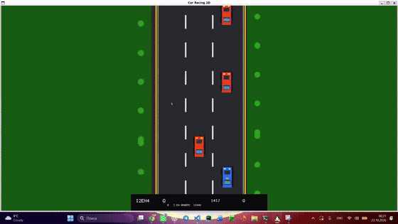

# Car Racing 2D

**Орындаған: Мүсілім Жансерік**

## Ойын туралы

Мен бұл ойынды C++ және OpenGL арқылы жасадым. Ойын жоғарыдан көрінеді. Көк көлікті басқарып, жолдағы басқа көліктерге соғылмау керек. Жол сызықтары мен ағаштар төмен қарай жылжиды. Кедергіден өтіп кетсең, ұпай қосылады. Соқтығысқанда ойын аяқталады.

## Қолданылған құралдар

- C++17
- OpenGL
- GLFW терезе мен пернетақтаны басқару үшін
- OpenAL дыбыстар үшін

## Файлдар

- `main.cpp` ойынның негізгі коды
- `run.sh` ойынды жинап, іске қосады
- `Car_Racing_2D_Esep.docx` ойын туралы есеп
- `KOD_TUSINDIRMESI.md` кодтың қарапайым түсіндірмесі
- `gameplay.mp4` ойынның толық экран жазбасы
- `gameplay_preview.gif` README ішінде автоматты көрсетілетін қысқа көрініс

## Ойыннан видео

Төмендегі қысқа көрініс осы ойынның экран жазбасынан жасалды. Толық видеоны ашып көру үшін сілтемені бас:



[▶ Толық ойын видеосын көру](gameplay.mp4)

## Ubuntu-да іске қосу

Алдымен керек кітапханаларды орнат:

```bash
sudo apt update
sudo apt install g++ make libglfw3-dev libgl1-mesa-dev libopenal-dev
```

Содан кейін ойын бумасына кіріп, іске қос:

```bash
cd ~/car_racing_2d
chmod +x run.sh
./run.sh
```

Ойын графикалық жұмыс үстелі ашық Ubuntu жүйесінде жұмыс істейді.

## Басқару

- `A` және `D` немесе сол және оң жақ бағыт пернелері көлікті бұрады.
- `Enter` ойынды бастайды немесе қайта бастайды.
- `S` баптау мәзірін ашады.
- Баптау мәзірінде `L` тілді ауыстырады.
- `M` дыбысты қосады немесе өшіреді.
- `C` қиындық деңгейін өзгертеді.
- `-` және `+` дыбыс деңгейін өзгертеді.
- `Esc` мәзірден қайтады немесе ойынды жабады.

## Ойын қалай жұмыс істейді

Негізгі ойын циклі әр кадр сайын пернетақтаны тексереді, көліктердің орнын жаңартады, соқтығысуды қарайды және көріністі қайта салады. Ойыншы көлігі үдеу мен инерция арқылы қозғалады. Қарсы көліктер кездейсоқ жолақта пайда болады. Олардың біреуі ойыншыға тисе, ойын аяқталады. Ойыннан өтіп кеткен көлік үшін ұпай беріледі.

Толығырақ түсіндіру `KOD_TUSINDIRMESI.md` файлында.
